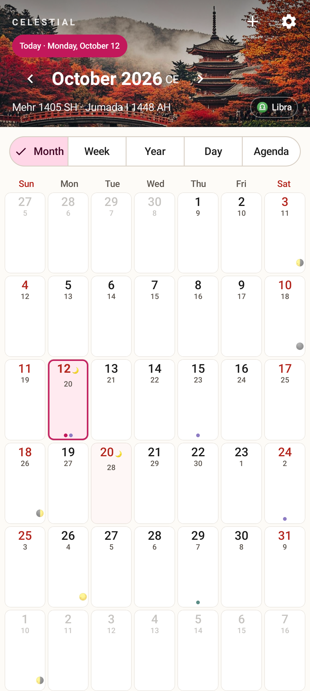
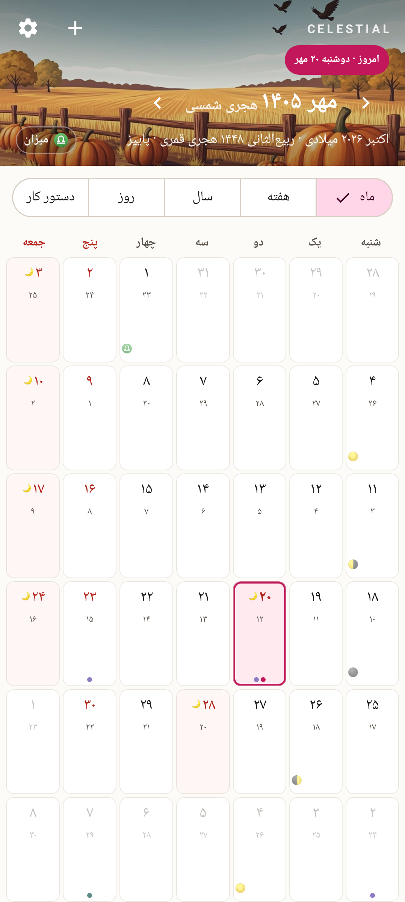
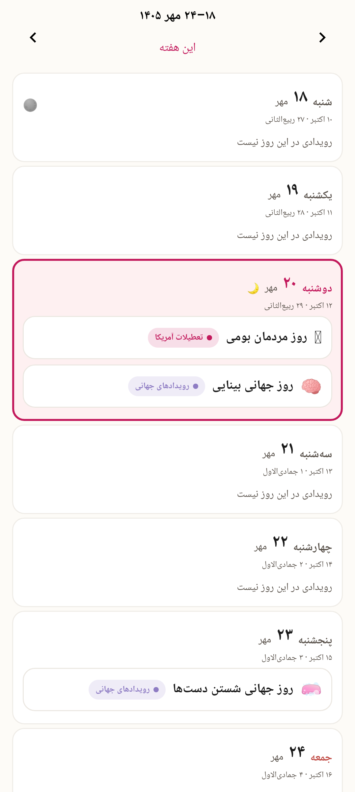
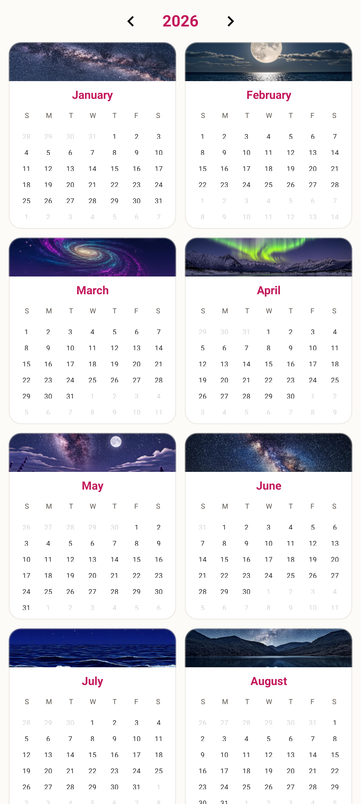
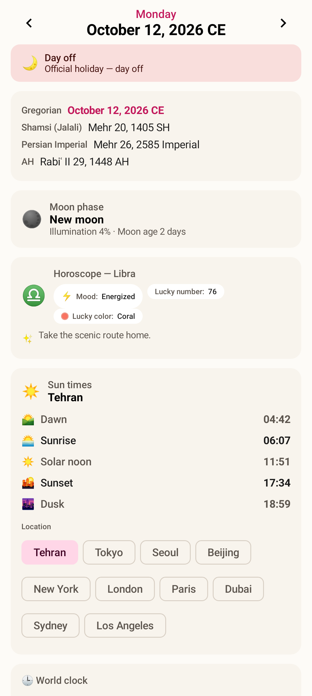
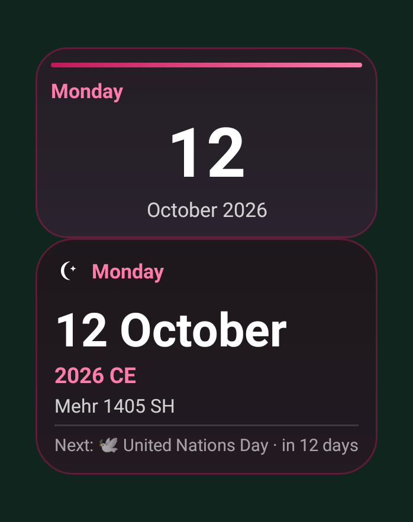

# Celestial 🌙✨

**A journey through time** — a multi-calendar app for the web and Android, celebrating three calendar systems, three languages, and the seasons of the year.

| Web (Next.js 16) | Android (Kotlin + Compose) |
|---|---|
| `/` (this repo root) | [`android/`](android/README.md) |

## Features

- **Five calendar systems** (web + Android)
  - **Gregorian** (CE)
  - **Shamsi / Jalali** (Solar Hijri, ه.ش) — pure engine validated 432/432 against ICU across 1930–2090
  - **Persian Imperial** (optional) — the ancient royal calendar on the Shahanshahi era of Cyrus the Great (559 BCE; year = Jalali + 1180 — today 2585): 12 fixed 30-day months + 5 *Andarjah* epagomenal days (6 in leap years), each day carrying its Zoroastrian devotional name (Ormazd, Bahman, …)
  - **Shahanshahi year, Shamsi months** (optional) — the Imperial year (today 2585) on the standard Jalali month/day structure, for those who want the royal era with familiar months
  - **Ancient / Fasli** (optional) — the 30-day Zoroastrian structure with the *ancient* month names (امرداد Amordad, اسپندارمذ Spandarmad, …) and Andarjah
  - **Royal month names** — a settings toggle swaps the Imperial calendars' month names to their ancient Zoroastrian forms (مرداد → امرداد, اسفند → اسپندارمذ)
  - **Hijri** (AH) shown alongside for religious dates
- **Three languages**: English, 日本語, فارسی (full RTL + Persian digits ۱۴۰۵) — every event name & description is translated
- **Events & holidays**
  - International observances (Valentine's, Earth Day, Halloween …)
  - 🇺🇸 US & 🇯🇵 Japan public holidays — fetched **live from the internet** (Nager.Date) with a built-in offline fallback
  - Persian cultural events (Yalda, Mehregan, Tiregan, Sadeh, Charshanbe Suri, Cyrus Day …)
  - Persian religious events (computed from the Hijri lunar calendar — Ashura, Eid al-Fitr, Eid al-Ghadir …)
  - Iranian national holidays (Nowruz 1–4, Nature Day, 22 Bahman …)
  - **Religious events can be hidden** — but legal holidays still appear as days-off
  - **Manual events** — create personal events right on the selected day (title, description, day-off flag) with ✍️ source badge — plus **full editing** (change anything, delete) and **yearly recurrence** 🔁 (birthdays, anniversaries — Feb 29 → Feb 28 fallback)
- **Astronomy** 🌑♈ — moon phases AND solstice/equinox markers: Meeus-derived engines (identical on web & Android): major-phase glyphs in month/week cells, a full phase card in Day view (name, illumination %, moon age), ♈♋♎♑ season glyphs with local event times. Both validated against live references (moon: 149/153 day-markers, new/full instants within ±5 min; solstices: 8/8 anchors within ±17 min). The JP 春分の日/秋分の日 holidays are computed astronomically (JST bucketing) — matching the official Japanese calendar in every year
- **Offline import** — **JSON / TXT / CSV / ICS** with downloadable samples ([`public/samples/`](public/samples)); Jalali (1405-07-01) and Gregorian (2026-10-01) dates auto-detected, Persian digits accepted; `.ics` parses Google/Apple/Outlook exports (yearly RRULE + multi-day events) — a full round-trip with our own export
- **ICS export** — download the agenda as a standards-compliant `.ics` (RFC 5545: CRLF, octet folding, escaped text) for Google/Apple/Outlook; yearly events export with `RRULE:FREQ=YEARLY`
- **Next-day-off countdown** — a pill in the header shows the next holiday and how many days away (respects your source toggles)
- **NTP time sync** — live UDP query to `pool.ntp.org` with offset display
- **PWA** 📲 — installable (manifest + service worker): works offline — the SW caches visited event ranges and the app shell, and a **client-side builtin engine** serves every builtin event even with no network (an "Offline" chip flags degraded data; data refreshes automatically on reconnect)
- **Event notifications** 🔔 — opt-in browser notifications for today's holidays & events (settings toggle + test button; fires once per day, respects your source toggles)
- **Backup & restore** — one-click JSON export of all your events + settings, and restore (replace-all) on any device
- **Print** 🖨 — `Ctrl+P` or the toolbar printer button prints a clean paper month: print-only masthead, red holidays, colored event dots preserved
- **Persian zodiac chips** ♎ — month view (zodiac of the month) and Day view (zodiac of the day), all languages incl. RTL
- **Seasonal artwork** — 3 illustrations per season with gentle CSS animations (spring cherry petals, summer fireflies, autumn leaves, winter snow); respects `prefers-reduced-motion`
- **Views**: Month (dual-date cells: big Shamsi + small Gregorian), **Week** (7 day-cards), Year, Day (all systems at once), Agenda (90 days)
- **Keyboard navigation** — arrows to move, `T` today, `M/W/Y/D/A` views, `C` date converter, `/` search, `?` shortcut help (works in RTL too)
- **Date converter** ⭄ — press `C` (or the hero toolbar button) to convert any date between Gregorian, Jalali and Imperial side-by-side, with live weekday / moon-phase / zodiac chips, "use today" and "show in calendar" jumps; accepts Persian digits ۱۴۰۵
- **ISO week numbers** — optional left-edge week column in the month grid (settings toggle; ISO 8601 Thursday rule, verified 47,847 days 1970–2100), also on paper when printing
- **iOS install hint** — iPhone/iPad users get a footer "Share → Add to Home Screen" chip (dismissable) since iOS Safari never offers the standard install prompt
- **Header artwork themes** (web + Android) — 7 selectable hero themes: Seasonal (fresh spring/summer artwork), Celestial (Milky Way night skies), Magical (enchanted forest & aurora), Shahanshahi (Persepolis & royal gardens), Japanese (ukiyo-e Fuji & torii), Korean (moonlit hanok & palace), Chinese (shan shui ink wash & lanterns); natural wind-driven particle animation (tumbling leaves with gusts, swaying petals, wandering fireflies, twinkling stars, golden dust) — no more zoom-pan; all motion off under `prefers-reduced-motion`
- **Shahanshahi era** — the Imperial calendar now uses the correct epoch: year 1 = Cyrus the Great's coronation, 559 BCE (year = Jalali + 1180 → today 2585), per the 1976 Pahlavi reform (Wikipedia: *Shahanshahi calendar*)
- **Configurable weekly day off** — auto (Friday in the Persian locale, none elsewhere) or force Friday / Saturday / Sunday / none; day-off styling + agenda badges + next-day-off countdown all respect it
- **World observances** — 22 additional international days (World Food Day, Human Rights Day, World Health Day, International Day of Education, …), all trilingual
- **Daily horoscope** (web + Android, toggleable) — deterministic per-day-and-sign horoscope card in Day view: mood, lucky number, lucky color and advice, in all three languages
- **Hijri year toggle** — hide the AH year line (hero + day/week rows + event dialogs) from settings
- **Flag icons** — US/JP/IR flags and a globe render as crisp SVGs everywhere (Windows shows flag *emoji* as the letters "US"/"JP" — SVGs fix that)
- **Wide-screen frame** — on ≥1280px the app sits in a centered 1440px rounded card over a quiet backdrop instead of stretching edge-to-edge; month cells got white tile borders for clarity
- **Locale-aware date formats** — Persian shows day-before-month («۲۹ مهر ۱۴۰۵») with FULL weekday names (چهارشنبه, not چهار) outside the month grid; Japanese uses 年月日 ordering with weekday in parens (10月29日（水曜日）)
- **Sun times** ☀️ (web + Android) — dawn / sunrise / solar noon / sunset / dusk for any displayed day at your chosen city (10 presets or auto), computed by a zero-dependency NOAA engine (astronomical twilight, polar night & midnight-sun aware), rendered in the city's timezone
- **World clock** 🌍 (web + Android) — live times in your chosen time zones with next-day/previous-day markers, add/remove cities, updates every 30s
- **12-per-month hero art** — every fixed artwork theme now carries **twelve unique illustrations — one per Gregorian month** (seasonal: 3 per season, one per month-in-season): no two months share artwork in any theme, and the Year view month cards follow the ACTIVE theme's pool (central `themeImageSrc`) — 52 new artworks this round; the header cross-fades when you change months
- **Header particle animation (web + Android)** — every theme animates: wind-blown autumn leaves with gusts, swaying cherry petals, wandering fireflies, twinkle stars, magic sparkles, Persian gold dust; Compose Canvas port on Android honors the system "remove animations" switch (`prefers-reduced-motion` on web)
- **Android APK download** — grab the debug APK straight from the web app (footer chip or Settings → App) at `/celestial-debug.apk`
- **RTL toggle fix** — switch knobs no longer slide outside the track in Persian
- **RTL round-15 fixes** — Persian settings sheet close button no longer overlaps the title (logical `end` positioning); Android year-view arrows mirror correctly in RTL; the Persian week label reads «۱۸–۲۴ مهر» (range before month); the month-view day strip keeps a constant height with a proper holiday badge
- **Flexible settings**: week start (Sat/Sun/Mon), theme (light/dark), per-source toggles, online mode
- **Motion & polish** — Framer Motion view transitions, staggered cell entrances, card hover lifts, structured loading skeletons (week/day/agenda), thin custom scrollbars, print mastheads on Month/Week/Day/Agenda, dark-mode hero starfield + moonlight halo (all motion killed under `prefers-reduced-motion`)
- Android: home-screen **widgets** — compact **Today 2×1** (weekday + big day number), **date 4×2** and **month grid 4×5** with weekday header — plus **status-bar date** via persistent notification (full localized weekday + date), **manual events + .ics export**, low-power design

## Screenshots

**The Android app** — captured from the *real* Compose UI (JVM-rendered via [Roborazzi](https://github.com/takahirom/roborazzi) — no emulator, no mocks: actual layouts, actual trilingual strings, actual artwork):

| Month · English (Japanese art theme) | Month · فارسی (RTL + Jalali) | Week · فارسی |
|---|---|---|
|  |  |  |

| Year view (12 unique artworks) | Day view (sun times + world clock) | Home-screen widgets |
|---|---|---|
|  |  |  |

The web app is the same design — open the preview and switch languages / themes / calendar systems to see it live.

## Repository layout

```
├─ src/                    # Next.js web app
│  ├─ lib/calendar/        # calendar engine (jdn, jalali, imperial, hijri)
│  ├─ lib/i18n/            # en / ja / fa dictionaries
│  ├─ lib/events/          # datasets + rule expander + online layer
│  ├─ lib/import/          # JSON/TXT/CSV parsers
│  ├─ components/celestial/# UI components
│  └─ app/api/             # events · import · NTP routes
├─ android/                # Kotlin + Jetpack Compose app (see android/README.md)
├─ public/samples/         # sample import files (JSON/TXT/CSV)
├─ public/seasonal/        # seasonal header artwork
├─ scripts/validate-calendar.ts   # engine validation harness (432 checks)
└─ prisma/                 # ImportedEvent model (SQLite)
```

## Running the web app

```bash
bun install
bun run db:push     # SQLite + Prisma client
bun run dev         # http://localhost:3000
bun scripts/validate-calendar.ts   # 440/440 checks
```

### Building the Android APK

```bash
cd android
echo "sdk.dir=$HOME/android-sdk" > local.properties   # Android SDK 35 + build-tools
./gradlew assembleDebug                                # or: gradle assembleDebug
# → app/build/outputs/apk/debug/app-debug.apk (debug-signed, installable)
```
Requires JDK 17+ (with `jlink` — a full JDK, not a JRE) and Android SDK platform 35. The current debug APK is served by the web dev server at `/celestial-debug.apk`. A debug build is signed with the debug keystore and installs on any device with "install unknown apps" enabled; for Play-style distribution build `assembleRelease` with your own keystore.

### E2E smoke test

With the dev server running, `bun run smoke` (see `scripts/smoke.ts`) drives the app through the `agent-browser` CLI in its default session and exits 0/1 with a `SMOKE: PASS` / `SMOKE: FAIL (n)` summary. It covers: page title + hero, month grid (≥ 28 cells + today ring), all five views (Month/Week/Year/Day/Agenda), the settings sheet (`S`), search (`Ctrl+K`), the trilingual date converter (`C`, three calendar rows), a locale switch to 日本語 and back to English (the store is left in EN), and `/api/time/ntp` health from inside the page. Any console error or uncaught page error fails the run. Steps are best-effort (failures are reported and the run continues); per-step waits are ~15 s and every CLI call is hard-capped, so it never hangs.

## Accuracy notes

- Jalali engine: 33-year cycle (epoch Farvardin 1, 1386 AP = 2007-03-21 CE); matches ICU `persian` and the astronomical calendar for 1930–2090.
- Hijri: ICU `islamic-umalqura` (web) / tabular civil (Android). Religious dates may shift ±1 day with official moon sighting — as they do in real life.
- Moon phases: two-term Meeus ch.49 corrections (separate new/full vs quarter tables), per-timezone day bucketing at local noon. Markers can differ ±1 day when the true event falls within ~1 h of local midnight — 149/153 agreement with a live reference.
- Solstice/equinox: Meeus ch.25 truncated solar longitude + Newton solver — instants within ±17 min of USNO; JP equinox holidays bucket in JST (fixed-offset) and match the official calendar for every year tested (2024–2028).
- Online holidays: [Nager.Date](https://date.nager.at) v3 (no key, no tracking).
- Shahanshahi epoch: year 1 = 559 BCE (Cyrus the Great); year = Jalali + 1180 (1355 AP = 2535, per the 1976 reform).

## Credits

Seasonal + all header-theme artwork was generated for this project. Built with Next.js 16, Tailwind CSS 4, shadcn/ui, Prisma, Jetpack Compose, and a love for all calendars. 💜
